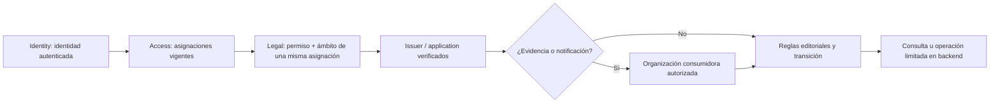

# Contrato propuesto de alcances de Legal v1

Estado: contrato administrativo y contexto implementados en Access y probados con la migración en PostgreSQL aislado. Pendientes despliegue compartido y evaluación local de permisos en Legal. Complementa el [catálogo de Legal](propuesta-autorizacion-legal.md).

## 1. Decisión de alcance

Cada asignación une **un rol, un ámbito editorial y una cobertura de organizaciones consumidoras cuando corresponde**. No separar permisos y destinos en listas globales que permitan combinar privilegios de asignaciones distintas.

| Dimensión | Significado y autoridad |
| --- | --- |
| `membership_id` | Pertenencia interna del empleado y elegibilidad, administradas por Access. |
| `resource_scope` | Issuers/applications de Legal sobre los que el rol permite actuar. Legal valida existencia, estado y relaciones. |
| `consumer_scope` | Organizaciones de Access cuya evidencia/notificaciones puede operar el titular dentro del ámbito editorial. |
| Tenant operativo de Legal | Contexto local para provisioning/operación. No concede permisos ni sustituye los destinos anteriores. |
| Tenant del producto consumidor | Identificador del producto dentro de una application y organización. No equivale al tenant de Legal ni se acepta sin validar esa relación. |

Los nombres de campos siguientes son el contrato propuesto; no son DTOs actualmente aceptados por Access.

## 2. Ámbito editorial

`resource_scope` es obligatorio y tiene una sola variante por asignación:

```json
{"type":"legal_global","ids":[]}
{"type":"issuers","ids":["uuid-emisor"]}
{"type":"applications","ids":["uuid-aplicacion"]}
```

- `legal_global`: todos los emisores/aplicaciones actuales y futuros del sistema Legal. Es una concesión amplia explícita, no un valor por defecto. Su creación queda reservada a plataforma y no se delega en v1.
- `issuers`: lista no vacía. Incluye aplicaciones actuales y futuras pertenecientes a esos emisores. Concede únicamente las acciones del rol, no todo acceso administrativo.
- `applications`: lista no vacía. Incluye documentos/versiones de esas aplicaciones. Permite leer **solo metadatos mínimos del emisor padre necesarios para identificar la aplicación**, sin consultar datos completos/sensibles del emisor, modificarlo ni listar aplicaciones hermanas. El backend necesita una proyección limitada; no reutilizar indiscriminadamente el detalle completo de issuer.
- Crear un issuer exige `legal.issuers.create` y `legal_global` en la misma asignación. Crear una application exige `legal.applications.create` y autoridad sobre el issuer padre. Crear un documento exige autoridad sobre la application destino.
- Transferir una application/documento entre padres exige permiso y alcance para ambos extremos. Para v1, prohibir cambios de padre de recursos con publicaciones/evidencia, porque una transferencia podría ampliar o retirar acceso histórico. Un eventual traslado histórico necesitará un procedimiento propio, auditado y versionado.
- Archivar/suspender un recurso impide mutaciones incompatibles con su estado; los roles de lectura/auditoría pueden consultar su historia dentro del alcance. Restaurar requiere una operación expresamente permitida. El estado archivado no borra la evidencia.

## 3. Cobertura de organizaciones consumidoras

Para `legal.auditor` y `legal.notification_operator`, `consumer_scope` es obligatorio:

```json
{"type":"all_organizations","organization_ids":[]}
{"type":"organizations","organization_ids":["uuid-organizacion-access"]}
```

- `all_organizations`: todas las organizaciones actuales y futuras **dentro de los issuers/applications autorizados**. Nunca autoriza datos de otra aplicación. Solo plataforma crea esta amplitud en v1.
- `organizations`: conjunto no vacío y explícito; se intersecta con el ámbito editorial de esa misma asignación.
- Una organización incluida delimita sus registros consumidores dentro de las aplicaciones autorizadas; Access verifica su existencia y estado. V1 no ofrece subalcance por tenant: una petición que lo solicite se rechaza, no se amplía silenciosamente a toda la organización.
- La organización de pertenencia del empleado nunca se usa como destino predeterminado de evidencia.
- Evidencia/notificaciones con organización nula o relación no verificable quedan excluidas de la consola operativa v1, también de `all_organizations`. No interpretar `null` como “todas”. Su saneamiento/clasificación posterior debe mantener la historia y no inventar relaciones.
- Suspender una organización consumidora detiene acciones de entrega incompatibles con ese estado, pero no debe impedir por sí solo que un auditor autorizado consulte evidencia histórica. Suspender la membresía **del operador** sí retira su autoridad.

Los otros cuatro roles requieren explícitamente:

```json
{"type":"not_applicable","organization_ids":[]}
```

No pueden adjuntar organizaciones para aparentar que su edición es exclusiva de un cliente. Tampoco pueden leer evidencia usando los permisos editoriales.

## 4. Combinaciones admitidas

| Rol | `resource_scope` | `consumer_scope` |
| --- | --- | --- |
| `legal.viewer` | legal_global / issuers / applications | not_applicable |
| `legal.editor` | legal_global / issuers / applications | not_applicable |
| `legal.publisher` | legal_global / issuers / applications | not_applicable |
| `legal.catalog_manager` | legal_global / issuers | not_applicable |
| `legal.auditor` | legal_global / issuers / applications | all_organizations / organizations |
| `legal.notification_operator` | legal_global / issuers / applications | all_organizations / organizations |

**Publicación v1:** `legal.publisher` autoriza publicar para el issuer/application completo. No existe una concesión de publicación limitada por organización consumidora en este contrato. Las reglas de publicación pueden delimitar destinatarios, pero esos destinatarios no reducen la autoridad del publicador. La UI y el catálogo deben explicar ese alcance al concederlo.

Esta decisión responde al modelo actual: `publishDraft` crea una versión/publicación por documento, las publicaciones tienen unicidad por documento/versión y se guardan con organización/tenant nulos, mientras las reglas contienen destinatarios. Ofrecer un permiso de publicación por cliente exigiría demostrar aislamiento de todos esos efectos y del procesamiento asíncrono. No lo simulamos añadiendo un filtro al DTO.

## 5. Evaluación por recurso

Una acción se autoriza si existe **una asignación vigente** que simultáneamente:

1. Corresponde a Legal, identidad compuesta y membresía interna activa; delegación/procedencia siguen vigentes.
2. Incluye el permiso exacto en el catálogo local.
3. Incluye el recurso o su padre verificado en `resource_scope`.
4. Para evidencia/notificaciones, incluye su organización en `consumer_scope`.
5. Cumple las restricciones de estado/transición y representación que aplique al dominio.

Para operaciones sobre varios recursos, cada recurso debe estar cubierto por una asignación completa; no construir autorización combinando el permiso de una con el destino de otra. Un resultado de búsqueda es la unión de las filas autorizadas por asignación, no el producto cartesiano de listas independientes.

Los predicados de autorización deben incorporarse al SQL **antes** de paginar, contar, agregar o exportar. Los filtros del cliente solo reducen el conjunto autorizado. Detalle/descarga/reintento por UUID comprueban exactamente el mismo ámbito. No devolver todos los registros y filtrarlos en frontend.

### Auditoría con contextos distintos

`legal.audit.view` necesita clasificar cada evento:

- Evento editorial sin datos de consumidores: se evalúa por issuer/application verificados.
- Evento de evidencia/notificación/exportación con datos de consumidores: se evalúan también las organizaciones afectadas. Un evento que agrupe varias exige cobertura de todas o una proyección segura explícita.
- Evento sin contexto suficiente: denegado hasta poder resolver sus relaciones desde fuentes confiables. No deducir contexto del primer registro de una exportación ni de filtros opcionales.

Un identificador de aceptación o metadata sensible dentro de un evento no se vuelve público por carecer de `organization_id`. La clasificación debe estar definida por tipo de evento y cubierta por pruebas.

## 6. Ejemplo de Ana sin combinaciones accidentales

Ana pertenece a Hemia Interna y tiene estas asignaciones independientes:

| Asignación | Rol | Applications | Organizaciones de evidencia |
| --- | --- | --- | --- |
| A | legal.viewer | Legal-App-1, Legal-App-2 | No aplica |
| B | legal.publisher | Legal-App-1 | No aplica: publicación a nivel aplicación |
| C | legal.auditor | Legal-App-1 | Acme |
| D | legal.auditor | Legal-App-2 | Beta |

Ana puede leer documentos de ambas aplicaciones y publicar únicamente en App-1. Puede exportar evidencia de Acme/App-1 y Beta/App-2. **No** puede exportar Beta/App-1 ni Acme/App-2. Su rol viewer amplio no amplía B/C/D. Revocar C retira Acme/App-1 sin afectar la lectura editorial A.



## 7. Validación y delegaciones

- Campos desconocidos, tipos incorrectos, destinos vacíos en variantes seleccionadas, listas en variantes globales, duplicados, UUID inválidos o combinaciones no admitidas: rechazar. No normalizar un error a un alcance amplio.
- Cada ID debe existir en su dominio. Legal valida emisores/aplicaciones por API autenticada; Access valida organizaciones. Las relaciones de un recurso consultado se vuelven a comprobar en Legal; una validación al conceder no acredita su estado indefinidamente.
- Referencias acotadas por producto y tipo; nunca introducir IDs de issuer/application en columnas con FK a organizaciones.
- Para v1 conservar presupuesto agregado máximo de 64 asignaciones y 1.000 referencias por usuario/producto; contar referencias editoriales y de organizaciones. Validar al conceder/reemplazar y al resolver, sin truncar. La implementación debe definir además un límite de tamaño serializado compatible con el transporte.
- Una delegación solo concede el mismo rol, para destinatarios internos autorizados y dentro de **ambas dimensiones**. V1 permite delegar conjuntos explícitos de issuers/applications y organizaciones; no crear autoridad global ni `all_organizations` desde una delegación.
- Para evitar ampliar autoridad por reparentados, v1 exige contención por IDs del mismo tipo entre delegación y concesión; no convertir una delegación issuer en una concesión application por una comprobación puntual. El administrador puede solicitar una delegación explícita de esas applications.
- No autoasignación, no subdelegación. Cambiar cualquiera de las dimensiones revoca y reemplaza, con historial, auditoría, versión e invalidación en la misma transacción.
- Reemplazar delegación no transfiere sus asignaciones. Revocar/suspender al delegante invalida también a sus destinatarios, aunque pertenezcan a otra organización interna.

## 8. Implementación y trabajo siguiente

Access ya publica los seis roles y combinaciones permitidas mediante `POST /v1/system-roles/catalogs/legal/v1`, restringido a plataforma. Sus endpoints de asignaciones/delegaciones aceptan el DTO Legal y verifican perfil, autoridad, destinos, vigencia, límites y procedencia. Las mutaciones usan historial, auditoría e invalidación transaccionales. `GET /v1/me/context?product=legal` descubre organizaciones con concesiones efectivas; `POST /v1/me/context/resolve` con product_code=legal emite `hemia-context+jwt`, aud=legal-api y contrato/catálogo v1, sin global_roles ni permissions.

Cada elemento assignments conserva assignment_id, assignment_version, role_code, valid_from, expires_at y:

```json
{"resource_scope":{"type":"applications","ids":["uuid-app"]},"consumer_scope":{"type":"organizations","organization_ids":["uuid-organizacion"]}}
```

No se combinan dimensiones entre asignaciones. Límites: 64 concesiones, 1.000 referencias acumuladas y 128 KiB de claims. El token dura como máximo 300 segundos y se acorta por vencimientos de autoridad; esto no autoriza una caché consumidora de más de 60 segundos. Access no convierte la validez de una asignación en garantía sobre el estado actual de un recurso de Legal: su evaluador local debe comprobarlo en cada acción.

Actualización 2026-09-21: Legal ya consume este perfil con SDK 1.0.7, catálogo local de seis roles y predicados por asignación en PostgreSQL. Se eliminaron mapeo organizacional, fallback y sincronización de membresías para autorizar. Las lecturas reutilizan contexto verificado como máximo 60 segundos; las mutaciones consultan fresco. Entradas personales/de servicio implementadas; falta completar aceptación con el ambiente compartido. La migración y publicación se probaron en bases aisladas; no se modificó el esquema ni catálogo compartidos. No desplegar el nuevo contexto sobre el consumidor antiguo de Legal.

## Fuentes de la revisión

- [Targets de asignaciones de Access](../../access/apps/api/src/modules/system-roles/entities/system-role-assignment-target.entity.ts).
- [Tipos de scope de Access](../../access/apps/api/src/modules/system-roles/entities/system-role-scope.entity.ts).
- [Publicaciones de Legal](../../../legal/apps/api/src/modules/legal/entities/legal-publication.entity.ts).
- [Reglas de aceptación](../../../legal/apps/api/src/modules/legal/entities/legal-acceptance-rule.entity.ts).
- [Publicación, evidencia y exportaciones actuales](../../../legal/apps/api/src/modules/legal/services/legal.service.ts).

## Persistencia en Access

La migración [AddLegalSystemScopes](../../access/apps/api/src/database/migrations/1790010000000-AddLegalSystemScopes.ts) amplía las seis tablas con perfil de producto, dimensiones de alcance y destinos tipados. El backfill se ejecuta bajo transacción y bloqueo exclusivo, limita las filas existentes al perfil Billing y conserva su historial; la migración es forward-only y rechaza un `down` que descarte concesiones Legal. Las migraciones se ejecutan explícitamente, nunca al arrancar la aplicación.

## Consumidor Legal — 2026-09-21

Ver [contrato implementado de Legal](../../../legal/docs/legal/identity-access-contracts.md). La regresión HTTP/PostgreSQL usa JWT firmados y JWKS de prueba, verifica separación de aplicaciones/consumidores, evidencia, auditoría, filtros antes de paginar y rechazo de firma/audiencia incorrecta. No es certificación del recorrido con Identity/Access compartidos. Se conservan datos históricos de tenants/roles sin consumirlos para autorizar; Legal opera sin tenant local. No se aplicaron migraciones compartidas. HORUS sigue TODO.

### Actualización 2026-09-22: consumidores sin tenant local

Legal separa consola, accesos personales y evaluación técnica. No crea ni consulta tenants locales para autorizar; Access confirma organización, membresía, habilitación y roles organizacionales vigentes. Estos roles solo evalúan reglas de representación, nunca conceden roles internos. La migración preparada cambia Legal a `provisioning_mode: none`; las nuevas aceptaciones se identifican por identidad/organización/versión/regla. Historia antigua preservada y validada, sin fallback ni compatibilidad. Ver [contrato implementado y despliegue](../../../legal/docs/legal/personal-service-authorization.md). Pruebas aisladas verificadas; registros de clientes y migraciones compartidas pendientes. HORUS sigue TODO.

Actualización operativa 2026-09-22: las migraciones compartidas de desarrollo y el catálogo ya están aplicados; clientes/políticas configurados y lecturas personales con revocación verificadas contra servicios reales. Ver [evidencia y pendientes específicos](activacion-legal-desarrollo-2026-09-22.md). El caso técnico permitido y su revocación ya se verificaron con billing-legal-service real. La aceptación documental sigue pendiente en el ambiente compartido.

Aceptación documental compartida verificada el 2026-09-22: consumidor sin roles internos, tenant nulo, hash/auditoría comprobados en PostgreSQL, aislamiento y revocación de operadores. El recorrido SSO se ejecutó por HTTP; no se declara prueba visual del frontend. [Evidencia y limpieza](activacion-legal-desarrollo-2026-09-22.md#cierre-de-aceptación-conectada--2026-09-22).
