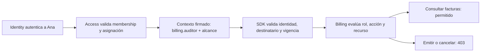

# Propuesta de autorización para Hemia Billing

**Estado:** correcciones de backend e integración implementadas localmente; activación y aceptación integral pendientes.  
**Fecha:** 2026-09-11.  
**Última actualización:** 2026-09-15.  
**Paso 1:** catálogo y contrato definidos para implementación en [Contrato Billing v1](contrato-autorizacion-billing-v1.md), con [catálogo JSON](contracts/billing-authorization-v1.json).  
**Ámbito:** consola interna de Billing, asignaciones en Access e integración con el SDK.  
**Propuesta general:** [Autorización de sistemas internos](propuesta-autorizacion-sistemas-internos.md).

## 1. Objetivo

Definir roles funcionales para Billing, sus permisos operativos, el alcance sobre los datos y los cambios necesarios para aplicarlos. Access administra las asignaciones; Billing define y evalúa su significado.

La consola es una herramienta de operadores internos de Hemia. No es un portal de clientes. Una membership activa no concede por sí misma acceso a facturas, cambios comerciales ni operación sobre todos los clientes.

Este documento se basa en el código local revisado. No certifica la configuración de Access ni las bases desplegadas. Los roles y permisos v1 ya tienen implementación local. Esto no acredita su publicación en la base de un ambiente ni un despliegue.

El contrato v1 complementa esta propuesta y precisa sus decisiones antes abiertas: matriz rol–alcance, formato único de asignaciones, perfil del contexto, facultades administrativas y versionado. Sus definiciones concretas prevalecen sobre los ejemplos conceptuales de esta propuesta para implementar Billing; completar el paso 1 no significa que el runtime ya las aplique.

## 2. Responsabilidades

| Componente | Responsabilidad |
|---|---|
| Identity | Autenticar personas y clientes de servicio. No administrar roles operativos de Billing. |
| Access | Mantener membership, habilitación de Billing, roles asignables y asignaciones restringidas con alcance y vigencia. |
| SDK | Resolver sesión, organización activa y contexto firmado; validar y renovar ese contexto. |
| Billing | Definir el mapa rol–permisos y comprobar acción, recurso, alcance y estado de negocio. |

No reintroducir tenant de sesión ni memberships locales para implementar roles fijos. Billing conserva sus clientes de pago, suscripciones, facturas y demás entidades propias vinculadas a `organization_id`.

## 3. Roles propuestos

Los roles son componibles: una persona puede recibir varios mediante asignaciones explícitas. No habrá un rol universal de administrador por defecto ni herencia implícita desde `organization_owner`, `organization_admin` o `finance`.

| Rol | Finalidad | Acceso incluido | Exclusiones principales |
|---|---|---|---|
| `billing.viewer` | Consulta operativa básica | Dashboard, catálogo, suscripciones, checkouts, licencias y add-ons contratados | Facturas, auditoría, webhooks y escrituras |
| `billing.operator` | Operar compras y extras contratados | Lecturas de viewer, verificación de checkout, contratación y cancelación programada de add-ons | Catálogo comercial, facturación y reintento de webhooks |
| `billing.catalog_manager` | Administrar oferta comercial | Lectura, modificación y publicación del catálogo | Datos de clientes, facturas y operación de suscripciones por ese solo rol |
| `billing.invoice_operator` | Operar facturas | Lectura, emisión y cancelación de facturas | Catálogo, roles de acceso y otras operaciones comerciales |
| `billing.auditor` | Revisar actividad y evidencia | Lecturas de viewer, facturas y auditoría | Todas las escrituras y reintento de webhooks |
| `billing.integration_operator` | Diagnosticar y reprocesar integraciones | Lectura de suscripciones, checkouts, licencias y webhooks; reintento de webhooks | Modificación de catálogo y operación directa de facturas |

La lectura de facturas o auditoría puede exponer información sensible. No se concede al lector básico. Revisar el contenido de los DTOs, enlaces a artefactos y detalles de webhooks al validar cada rol.

## 4. Matriz exacta rol–permisos

Leyenda: **V** viewer, **O** operator, **C** catalog_manager, **F** invoice_operator, **A** auditor, **I** integration_operator. Todos los roles llevan el prefijo `billing.`.

| Permiso | V | O | C | F | A | I |
|---|:-:|:-:|:-:|:-:|:-:|:-:|
| `billing.dashboard.read` | Sí | Sí | — | — | Sí | — |
| `billing.catalog.read` | Sí | Sí | Sí | — | Sí | — |
| `billing.catalog.manage` | — | — | Sí | — | — | — |
| `billing.catalog.publish` | — | — | Sí | — | — | — |
| `billing.subscriptions.read` | Sí | Sí | — | — | Sí | Sí |
| `billing.checkout.read` | Sí | Sí | — | — | Sí | Sí |
| `billing.checkout.verify` | — | Sí | — | — | — | — |
| `billing.licenses.read` | Sí | Sí | — | — | Sí | Sí |
| `billing.addons.read` | Sí | Sí | — | — | Sí | — |
| `billing.addons.create` | — | Sí | — | — | — | — |
| `billing.addons.cancel` | — | Sí | — | — | — | — |
| `billing.invoices.read` | — | — | — | Sí | Sí | — |
| `billing.invoices.issue` | — | — | — | Sí | — | — |
| `billing.invoices.cancel` | — | — | — | Sí | — | — |
| `billing.audit.read` | — | — | — | — | Sí | — |
| `billing.webhooks.read` | — | — | — | — | — | Sí |
| `billing.webhooks.retry` | — | — | — | — | — | Sí |

Esta matriz es explícita; no expandir comodines como `billing.*` ni conceder permisos de lectura a roles desconocidos. Un rol ausente, deshabilitado o no reconocido concede cero permisos.

La separación de acciones no obliga a tener un rol por acción. El rol de facturación incluye emitir y cancelar, pero las acciones permanecen separadas para controles y asignaciones futuras. No crear roles personalizados sin un requisito concreto; la entrega incluye los seis roles definidos.

## 5. Permisos y endpoints que deben alinearse

Las rutas siguientes son relativas al prefijo de API, actualmente `/api/v1`. Las rutas `/auth/*` se encuentran fuera de ese prefijo.

| Superficie | Permiso anterior | Contrato v1 implementado |
|---|---|---|
| `GET /billing/console/dashboard/summary` | `billing.dashboard.read` | Conservar; revisar que el agregado respete el alcance admitido |
| Lecturas de `/billing/console/catalog/*` | `billing.catalog.read` | Conservar |
| Crear/editar productos, planes, features, versiones y add-ons del catálogo | `billing.catalog.manage` | Conservar para edición; no autoriza publicación de versiones |
| `POST /billing/console/catalog/plan-versions/:id/publish` | `billing.catalog.manage` | Exigir nuevo `billing.catalog.publish` |
| Lecturas de `/billing/console/subscriptions` y `/:id` | `billing.subscriptions.read` | Conservar |
| Lecturas de `/billing/console/checkouts` y `/:id` | `billing.subscriptions.read` | Exigir nuevo `billing.checkout.read` |
| `POST /billing/console/checkouts/:id/verify` | `billing.subscriptions.manage` | Exigir nuevo `billing.checkout.verify` |
| Lecturas de `/billing/console/licenses` y `/:id` | `billing.licenses.read` | Conservar |
| `GET /billing/console/subscriptions/:subscriptionId/addons` | `billing.addons.read` | Conservar y corregir su omisión en el catálogo de sesión |
| `POST /billing/console/subscriptions/:subscriptionId/addons` | `billing.addons.manage` | Exigir nuevo `billing.addons.create` |
| `POST /billing/console/subscription-addons/:id/schedule-cancel` | `billing.addons.manage` | Exigir nuevo `billing.addons.cancel`; significa programar cancelación |
| Lecturas de `/billing/console/invoices` y `/:id` | `billing.invoices.read` | Conservar |
| `POST /billing/console/invoices/:id/issue` | `billing.invoices.manage` | Exigir nuevo `billing.invoices.issue` |
| `POST /billing/console/invoices/:id/cancel` | `billing.invoices.manage` | Exigir nuevo `billing.invoices.cancel` |
| Lecturas de `/billing/console/audit` y `/:id` | `billing.audit.read` | Conservar |
| Lecturas de `/billing/console/webhooks` y `/:id` | `billing.webhooks.read` | Conservar |
| `POST /billing/console/webhooks/:id/retry` | `billing.webhooks.retry` | Conservar como operación sensible |

Los permisos nuevos separan operaciones existentes; no agregan capacidades de negocio. El add-on del catálogo es una oferta comercial y se administra con `catalog.manage`; el add-on contratado por una suscripción se opera con `addons.create/cancel`.

## 6. Ajustes funcionales y de seguridad

### 6.1 Sustituir la autorización central de acciones por roles explícitos

Billing valida producto, membership, asignaciones, rol y alcance desde el contexto firmado; deriva localmente los permisos. La consola ya no exige `billing.console.access` ni permisos operativos centrales. El scope OAuth no sustituye una asignación. El SDK verifica el contexto al resolverlo; Billing valida sus claims y evalúa permisos y alcance en cada petición. Las lecturas pueden reutilizarlo por hasta 60 segundos.

### 6.2 Proteger todos los caminos de publicación

Implementado: altas y ediciones genéricas solo admiten versiones draft, incluyendo versiones anidadas en planes. Publicar requiere el endpoint específico y `billing.catalog.publish`; la transacción bloquea el plan y la versión y archiva la versión publicada anterior. Las publicaciones concurrentes del mismo plan se serializan. El frontend crea drafts y ofrece una acción explícita de publicación al rol autorizado. `catalog.manage` conserva la activación comercial de productos y add-ons.

### 6.3 Corregir el catálogo de permisos y el frontend

El mapa local incluye `billing.addons.read`; navegación y acciones usan permisos explícitos, sin scopes alternativos ni comodines. Emisión/cancelación de facturas y publicación de versiones tienen controles separados. Los controles visuales no reemplazan al backend. La página de operaciones aún es provisional; se requiere aceptación de todas las pantallas por rol antes de declarar completo el frontend.

### 6.4 Conservar límites entre personas y servicios

Cancelar suscripciones y cambiar planes aparecen actualmente en un controlador protegido por `BillingInternalAuthGuard`. No son capacidades de consola disponibles para personas por asignarles `billing.operator`.

Mantener las APIs de máquina separadas y sus scopes explícitos, incluidos `billing.integration.catalog.read`, `billing.integration.checkout.create/read` y `billing.integration.licenses.read`. No reutilizar roles de persona como scopes de servicio ni abrir rutas internas a cookies de usuario.

Si se solicita operación humana de cancelación de suscripciones o cambio de plan, definir posteriormente rutas de consola, permisos específicos, alcance, auditoría y pruebas. No incluir permisos de operaciones que no existen en la consola.

### 6.5 Auditar emisión y cancelación de facturas

Implementado: el actor se obtiene de la identidad verificada (`issuer`, `subject`, referencia de Access) y se registra con factura, organización, acción, resultado y trace ID generado por servidor. No se acepta el operador del frontend.

La creación bloquea el pago para evitar facturas activas duplicadas. Emisión/cancelación reservan la operación y su auditoría en una transacción antes de contactar al proveedor, con clave estable por factura/acción. Una segunda petición no vuelve a invocar al proveedor mientras el resultado está pendiente o incierto; un resultado confirmado se devuelve de forma idempotente. Un timeout o caída exige reconciliación mediante los endpoints internos tras consultar al proveedor; no se reenvía ciegamente. El cierre de la operación y su auditoría son atómicos. Esto no constituye una transacción distribuida ni sustituye la idempotencia del proveedor.

El contrato del adaptador recibe la clave de idempotencia. El repositorio todavía usa `NoopBillingInvoiceIssuerAdapter`, que falla explícitamente en producción; configurar/probar un PAC real es requisito operativo pendiente.

### 6.6 Tratar verificación y reintento como operaciones con efectos

Verificar checkout puede reconciliar estados comerciales. Reintentar un webhook ejecuta procesamiento que puede afectar pagos, suscripciones o licencias. No tratarlos como lecturas ni concederlos automáticamente a auditores.

Conservar en el reintento los controles existentes de evento verificado, estado fallido, motivo y operador; validar además alcance y revocación antes de ejecutar.

## 7. Alcances y vigencia

### 7.1 Alcances obligatorios de la entrega

| Alcance conceptual | Aplicación |
|---|---|
| `catalog_global` | Administración del catálogo compartido por Hemia |
| `all_customers` | Consulta u operación explícita sobre todos los clientes administrados por Hemia |
| `organizations` | Restricción efectiva a organizaciones específicas; debe imponerse en backend antes de declarar completa la entrega |

La organización del operador, por ejemplo `org_hemia`, autoriza su participación interna. No es necesariamente la organización propietaria de una factura. No convertir automáticamente la membership en permiso global.

El acceso transversal debe ser explícito al asignar el rol. Por ejemplo:

```yaml
# Asignación propuesta; no representa el esquema actual de Access.
system: billing
role: billing.invoice_operator
scope:
  type: all_customers
```

Los roles de consulta operativa pueden incluir lectura del catálogo público operativo según su matriz; eso no concede administración global del catálogo. Billing debe definir qué tipos de recurso cubre cada alcance admitido.

### 7.2 Restricciones por cliente

Las consultas revisadas usan filtros de organización opcionales y algunas búsquedas solo por ID. Para entregar soporte real de alcance limitado a Acme es obligatorio:

- Derivar el conjunto permitido del contexto verificado, no de parámetros del frontend.
- Restringir listados y búsquedas por ID, así como todas las escrituras.
- Resolver la organización propietaria desde la suscripción/factura/checkout autorizado, incluyendo add-ons y eventos relacionados.
- Aplicar límites a agregados del dashboard, auditoría, artefactos, cachés y trabajos derivados.
- Denegar cuando no pueda determinarse el alcance; no interpretar un recurso sin organización como globalmente permitido.

Mantener rol y alcance unidos por asignación. Consulta global más escritura limitada a Acme no equivale a escritura global. No construir una unión independiente de todos los permisos y todos los alcances.

### 7.3 Revocación

La política implementada es híbrida: GET/HEAD reutilizan contexto verificado por hasta **60 segundos**; toda mutación consulta Access de nuevo. La ventana no se desliza al leer y se limita por el inicio de resolución, `iat + 60` y `exp`. El JWT dura como máximo cinco minutos y nunca más que la vigencia de las autoridades de origen. Ante caída de Access, solo continúan lecturas con contexto vigente y no invalidado; renovación y mutaciones se deniegan. Véase [ADR-014](../../docs/ADR/documentoADR.md#adr-014).

La invalidación por eventos sigue vigente, con versiones, auditoría y outbox transaccional, dependencias entre organizaciones y publicación continua. No cancela operaciones ya autorizadas en ejecución. El SDK comparte caché y bloqueo distribuido mediante Redis. Las generaciones por identidad/organización impiden reutilizar o reinstalar contextos anteriores al evento; eventos repetidos o desordenados pueden causar una renovación adicional, nunca restaurar autoridad. Si se pierde un evento, la ventana máxima aceptada para nuevas lecturas es 60 segundos.

## 8. Administración de asignaciones en Access

- Solo autoridades de plataforma pueden asignar roles internos de Billing. `platform_super_admin` es excepcional; la administración cotidiana admite delegación restringida por sistema, rol y alcance, sin ampliación de la propia autoridad.
- Validar organización interna elegible, membership activa, sistema y rol reservado tanto por ID como por código.
- Impedir creación de roles organizacionales que suplanten roles de sistema.
- No conceder roles operativos automáticamente a owners o administradores de clientes.
- Auditar altas, cambios, vencimientos y revocaciones.
- Mantener descripción y alcances admitidos del rol alineados con el catálogo versionado de Billing.

No sembrar indiscriminadamente permisos operativos en el catálogo global de Access. La matriz actual de `organization_owner` debe revisarse antes de ampliar catálogos para evitar asignaciones implícitas no deseadas.

## 9. Ejemplo: Ana

Ana revisa la operación y las facturas, pero no las modifica. Access le asigna `billing.auditor` con alcance explícito `all_customers`. Billing deriva permisos locales de lectura de la matriz.



Si Ana debe emitir y cancelar facturas, una autoridad de plataforma le asigna adicionalmente `billing.invoice_operator` con su propio alcance. La autorización se evalúa por asignación, no mezclando alcances de roles distintos.

## 10. Plan de trabajo

| Fase | Entrega | Dependencia |
|---|---|---|
| 1. Catálogo y contrato | Implementados: seis roles, 17 permisos, alcances y contexto v1 | Publicación explícita por ambiente |
| 2. Access/SDK | Roles registrados, asignación restringida y contexto verificable | Contrato acordado |
| 3. Política Billing | Mapa local, organizaciones elegibles y guards alineados | Emisión de roles desde Access |
| 4. Acciones | Separar permisos, cerrar publicación alternativa y completar auditoría | Política local |
| 5. Frontend | Navegación y acciones alineadas con cada rol | Contratos del backend |
| 6. Validación integral | Los seis roles y todos los alcances probados de extremo a extremo | Contexto, backend y frontend integrados |
| 7. Producción | Pruebas de concurrencia/carga, observabilidad y corte coordinado | Criterios de aceptación completos |

Billing continúa sin tenant de sesión. El seed del producto en Access ya usa `none`; para registros existentes el ajuste es una operación administrativa explícita por ambiente. No eliminar la tabla histórica de tenants ni sus datos dentro de este cambio; comprobar y trasladar bloqueos vigentes antes de una limpieza posterior.

No ejecutar migraciones ni seeds en el arranque, no habilitar `synchronize` o `migrationsRun` y no añadir compatibilidad legacy. Esta propuesta no autoriza despliegues ni modificaciones de datos de producción.

## 11. Pruebas de aceptación

- Cada rol permite exactamente las acciones de la matriz y deniega las restantes.
- Roles ausentes, desconocidos, vencidos o revocados conceden cero permisos.
- El lector básico no accede a facturas, auditoría ni detalles de webhooks.
- El administrador de catálogo no obtiene acceso a datos comerciales de clientes por ese solo rol.
- `billing.addons.read` llega correctamente a la sesión del operador autorizado.
- Las rutas genéricas de creación/edición no permiten publicar versiones sin autorización de publicación.
- Emisión/cancelación de facturas registran al operador real y conservan invariantes ante peticiones concurrentes o repetidas.
- Reintentos de webhook conservan validación, motivo, auditoría y alcance.
- Una asignación de escritura limitada no hereda alcance global de otro rol de lectura.
- Un administrador cliente no puede asignar ni suplantar roles internos, tampoco por ID.
- Las APIs de máquina siguen rechazando sesiones de persona.
- Contextos de otro sistema, organización o identidad se rechazan.
- Revocación, expiración, selección de organización y caída de Access se comportan según el plazo acordado.
- La interfaz de cada rol funciona sin requerir permisos de otros roles para cargar su sección.

## 12. Referencias de implementación revisadas

- [Filtro actual de permisos de consola](/Users/cristianmendez/Documents/github/billing/apps/api/src/modules/auth/billing-console-permissions.ts).
- [Resolución de sesión](/Users/cristianmendez/Documents/github/billing/apps/api/src/modules/auth/billing-console-session.service.ts).
- [Operaciones de consola](/Users/cristianmendez/Documents/github/billing/apps/api/src/modules/operations/billing-operations.controller.ts).
- [Catálogo de consola](/Users/cristianmendez/Documents/github/billing/apps/api/src/modules/catalog/billing-catalog-console.controller.ts).
- [Servicio de catálogo](/Users/cristianmendez/Documents/github/billing/apps/api/src/modules/catalog/billing-catalog.service.ts).
- [Add-ons contratados](/Users/cristianmendez/Documents/github/billing/apps/api/src/modules/subscription-addons/billing-subscription-addons-console.controller.ts).
- [Facturas de consola](/Users/cristianmendez/Documents/github/billing/apps/api/src/modules/invoices/billing-invoices-console.controller.ts).
- [Servicio de facturas](/Users/cristianmendez/Documents/github/billing/apps/api/src/modules/invoices/billing-invoices.service.ts).
- [Webhooks de consola](/Users/cristianmendez/Documents/github/billing/apps/api/src/modules/webhooks/billing-webhooks-console.controller.ts).
- [Controlador de suscripciones para integraciones](/Users/cristianmendez/Documents/github/billing/apps/api/src/modules/subscriptions-management/billing-subscriptions-management.controller.ts).

Los enlaces absolutos corresponden al checkout local analizado. Al trasladar este documento al repositorio documental central, adaptar sus referencias.

## 13. Entrega definitiva, robusta y escalable

Esta propuesta no se limita a dos roles ni a un piloto con acceso global. La entrega comprende los seis roles, los alcances `catalog_global`, `all_customers` y `organizations`, administración segura y revocación verificable. Las etapas del plan organizan dependencias; no habilitan presentar una implementación parcial como terminada.

### Modelo central requerido

Access mantiene `system_roles` vinculados a Billing y versionados; `system_role_assignments` vinculadas a memberships, con alcance, vigencia y trazabilidad; y `system_role_assignment_targets` para las organizaciones de una asignación restringida. Cada rol declara alcances admitidos. Access valida esas combinaciones y Billing aplica su significado a cada recurso.

La referencia normativa del diseño propuesto es la [sección 9.8 de la propuesta general](propuesta-autorizacion-sistemas-internos.md#98-capacidad-definitiva-de-access-para-sistemas-internos). No duplicar un modelo de asignaciones local ni usar JSON libre con interpretaciones distintas entre consumidores.

### Catálogo y administración

Billing publica su definición versionada de roles y conserva el mapa ejecutable de permisos. Access registra el catálogo para asignaciones sin editar su significado. Administradores delegados solo conceden roles y alcances expresamente autorizados; no basta con `role.assign` organizacional ni con pertenecer a Hemia.

La elegibilidad de organizaciones de empleados internos se representa de manera explícita y administrada. Los cambios de elegibilidad, delegación, asignación y revocación se auditan. Establecer vigencias y retirar asignaciones forma parte de la capacidad operativa.

### Contexto y validación

El contrato incluye identidad compuesta, membership, organización del operador, sistema, audiencia Billing, asignaciones asociadas a alcance/vigencia, versión de contrato/contexto y timestamps. No consumir roles y alcances como conjuntos independientes.

El SDK verifica criptográficamente cada contexto recién resuelto y permite reutilización de lectura por 60 segundos; Billing rechaza contratos incompatibles en cada petición. La frecuencia y dependencia de disponibilidad de Billing quedan formalizadas en ADR-014. No se promete revocación instantánea de solicitudes ya en ejecución.

### Escalabilidad y operación

Access confirma cambios, versiones, auditoría y outbox transaccionalmente. La invalidación debe dirigirse por membership/asignación y evitar barridos globales de sesiones. Consumidores idempotentes y control de versiones impiden que eventos antiguos restauren privilegios.

Medir latencia y fallos de contexto, denegaciones, retraso de eventos y tiempo de revocación sin registrar tokens o secretos. Validar carga representativa, concurrencia de refresh, consultas con alcances restringidos y efectos repetidos de operaciones sensibles. Configurar alertas y procedimientos para fallos sostenidos de Access o de la entrega de eventos.

### Corte sin compatibilidad legacy

Coordinar migraciones, catálogo/asignaciones de Access, SDK y Billing. El nuevo flujo no acepta aliases, formatos alternativos de autorización, fallback de roles organizacionales ni los permisos centrales antiguos como sustitución de asignaciones. Coordinar invalidación o reautenticación de sesiones anteriores cuando no cumplan el contrato.

Las APIs de servicio siguen teniendo su dominio propio de autorización; no son un fallback para el acceso de personas. Las migraciones y seeds son tareas explícitas, nunca de arranque. No eliminar datos de negocio para realizar el corte.

### Criterios adicionales de producción

- Los seis roles funcionan sin permisos implícitos ni dependencias de navegación de otros roles.
- Todos los alcances admitidos se aplican a listados, detalles, agregados, escrituras y recursos relacionados.
- La delegación administrativa no permite autoescalación ni asignación fuera de autoridad.
- Se prueban vencimiento, caída de Access, pérdida/duplicación/desorden de eventos y concurrencia.
- La revocación cumple un objetivo medible con observabilidad y procedimientos operativos.
- El contrato y el catálogo versionados se despliegan coordinadamente sin compatibilidad legacy.


## 14. Estado verificado y activación

Access expone `POST /v1/system-roles/catalogs/billing/v1` (body vacío, plataforma), `POST /v1/system-roles/assignments` y `POST /v1/system-roles/delegations`, además de reemplazo/revocación. El registro usa la proyección versionada del catálogo de Billing, preserva roles deshabilitados y rechaza divergencias en una versión existente. Las altas son idempotentes por actor/clave, validan autoridad vigente, identidad interna y límites agregados. Una delegación con `canGrant` sin `canRevoke` permite altas pero no revocaciones. No hay autoasignación ni concesiones implícitas.

Webhooks: los operadores restringidos pueden leer/reintentar eventos verificados cuya organización se resuelve inequívocamente desde referencias del proveedor hacia suscripciones, add-ons o pagos locales. Listados y dashboard filtran antes del conteo; detalles y reintentos comprueban alcance, y el reintento vuelve a comprobarlo dentro de la transacción. Se deniega si la propiedad es desconocida/ambigua; campos `organization_id` o metadata del payload no conceden acceso.

No queda API key de entrada como alternativa al bearer de servicio; el frontend consume únicamente permisos explícitos. Las claves utilizadas para proveedores externos tienen otra finalidad y no son un fallback de autorización de consola.

Validación local: suites unitarias de Access/Billing, compilación y pruebas PostgreSQL Docker de altas, idempotencia, autoridad, límites, rollback, publicaciones concurrentes, emisión concurrente/reconciliación y alcance de webhooks. Docker usa datos sintéticos y broker/adaptador fiscal simulados. No se aplicaron migraciones ni seeds sobre bases configuradas durante esta entrega y no se concedieron roles a usuarios reales.

Activación pendiente: desplegar Access/SDK/Billing coordinadamente; configurar Billing como producto `none`; publicar catálogo; conceder asignaciones/delegaciones explícitas; configurar proveedor fiscal real; ejecutar login y aceptación de los seis roles/alcances con servicios externos. La UI de operaciones provisional, las métricas de producción y esa aceptación impiden declarar la entrega global terminada.

### Ambiente integrado preparado (2026-09-16)

El ambiente de desarrollo ya usa producto `none`, catálogo publicado y asignaciones explícitas. Se verificaron catorce casos HTTP, con trece usuarios, los seis roles y sus once combinaciones de alcance, selección entre organizaciones y casos denegados. Se comprobó la revocación mediante RabbitMQ y la ventana real de 60 segundos ante caída de Access. SDK 1.0.7 instalado localmente; proveedor fiscal, aceptación visual completa, transiciones restantes y carga siguen pendientes. Evidencia y operación: [ambiente integrado](../../docs/migracion/ambiente-integrado-billing.md).

### Aceptación ampliada de Billing — 2026-09-16

Verificados en desarrollo: renovación de token realmente vencido con 16 peticiones y dos instancias (un solo refresh hijo), aislamiento de dos clientes en listas/detalles/agregados y escrituras denegadas, concesión/revocación delegada, ausencia de transferencia automática y suspensión del administrador. Caída aislada de transporte RabbitMQ: outbox persistente, límite real de lectura de 60 segundos, recuperación automática y duplicados/eventos fuera de orden sin restitución de privilegios. SDK eventos 0.0.4 corrige la reconexión y confirma retry/DLQ antes del ACK; integrado localmente en Access/Billing. [Evidencia, reproducción y límites](../../docs/migracion/ambiente-integrado-billing.md). Siguen pendientes aceptación completa de UI/negocio, proveedor fiscal y medición/despliegue de producción; esta prueba no valida Legal.

## Cierre técnico de operación — 2026-09-16

Implementadas y probadas métricas, ocho alertas, entrega/recuperación al receptor local y carga del recorrido completo (2.635 operaciones, cero errores/descartes). Corregida la ausencia de Redis en Access de desarrollo. [Resultados, runbook y límites del cierre](../../docs/migracion/cierre-operativo-billing.md). El proveedor fiscal queda expresamente fuera del alcance. Cerrada la implementación y validación operativa en desarrollo; la observabilidad de producción queda como TODO de integración con HORUS, incluyendo métricas, alertas y verificación en destino. La aceptación comercial/UI es una entrega independiente.

## TODO: integrar observabilidad con HORUS

Decisión vigente: Hemia utilizará **HORUS**, su software propio, para la observabilidad de producción. Prometheus y Alertmanager no son requisitos del despliegue; su configuración y resultados locales se conservan únicamente como evidencia de las pruebas realizadas.

- [ ] Definir el contrato de integración con HORUS: transporte, formato, autenticación y frecuencia de envío o consulta. No asumir compatibilidad con el formato Prometheus existente.
- [ ] Integrar métricas de Identity, Access y Billing: HTTP, procesos, pool, dependencias y outbox.
- [ ] Configurar en HORUS umbrales, alertas, destinatarios y recuperación de incidentes.
- [ ] Validar la recepción de métricas y la entrega/resolución de alertas en el ambiente de destino.

La integración queda pendiente; no se implementa HORUS en este cambio. Las pruebas previas de SSO y carga conservan su validez. El proveedor fiscal sigue fuera del alcance.
