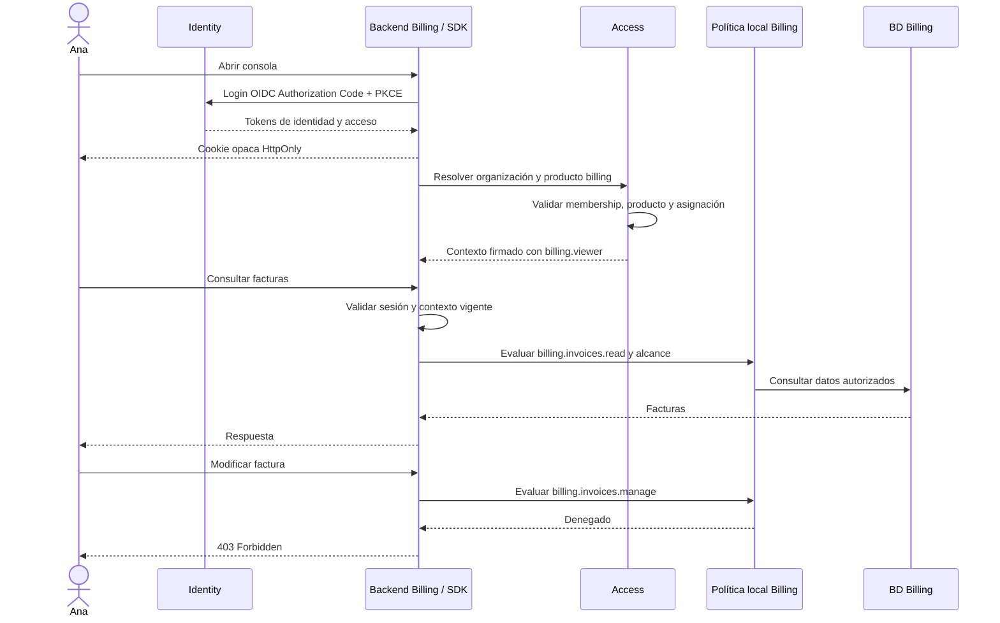

# Propuesta: autorización de sistemas internos de Hemia

**Estado:** propuesta para revisión e implementación; no reemplaza todavía los ADR vigentes.  
**Fecha:** 2026-09-10.  
**Última actualización:** 2026-09-11.  
**Ámbito:** Identity/SSO, Access, SDK `@hemia/auth`, Billing y Legal.  
**Objetivo:** simplificar la integración de las consolas internas sin duplicar tenants y memberships innecesariamente ni debilitar la autorización.

## 1. Problema y punto de partida

La documentación transversal asigna a cada producto tenant y permisos propios. La documentación específica de Billing, en cambio, describe permisos de consola proporcionados por Identity/Access. Es necesario resolver esa contradicción y separar tres decisiones: quién asigna roles, quién define su significado y cuándo hace falta un tenant local.

El análisis del código local encontró:

- **Identity:** implementa autenticación OAuth/OIDC. No debe emitir ni persistir tenants, roles, permisos u organization claims. Sus scopes OAuth no sustituyen las autorizaciones operativas de cada sistema.
- **Access:** mantiene organizations, memberships, roles, permisos globales y acceso a productos; calcula permisos mediante `membership_roles` y `role_permissions` y emite contexto firmado. Los seeds revisados no definen los permisos operativos que los cambios recientes de Billing exigen.
- **SDK:** resuelve login, sesión y lectura inicial de Access; aún necesita un contrato común completo para organización activa y ciclo de vida del contexto.
- **Billing:** sus datos comerciales usan `organization_id`. Se retiró del flujo de sesión la creación/consulta del tenant local. Los cambios recientes exigen permisos operativos explícitos de Access: deben adaptarse a esta propuesta. La tabla de tenants permanece sin uso en la sesión; no se han eliminado sus datos.
- **Legal:** catálogo de permisos en código y asignaciones explícitas de Access; opera por organización sin tenant local. Los eventos invalidan contexto, no sincronizan roles ni crean tenants.

Estas observaciones corresponden al código y documentación revisados, no certifican la configuración de bases de datos ni despliegues existentes. Los cambios de Billing no constituyen por sí solos una implementación de esta propuesta.

## 2. Decisiones propuestas

| Decisión | Recomendación |
|---|---|
| ¿Quién asigna acceso y roles a los empleados? | Access, de forma centralizada y por sistema. |
| ¿Quién define qué acciones permite cada rol? | El sistema: Billing define sus permisos; Legal define los suyos. |
| ¿Un administrador de organización administra todas las consolas? | No. Los roles de operador interno requieren asignación explícita y restringida. |
| ¿Todos los sistemas necesitan tenant local? | No. Billing puede usar `organization_id`; Legal usa también `organization_id`, sin tenant local para operar; los datos antiguos se conservan como historia. |
| ¿Qué debe resolver la integración común? | El SDK: sesión, organización activa, validación y renovación del contexto. |

**Principio:** asignaciones en Access; significado y evaluación en cada sistema.

Tener permisos locales no exige una tabla local de roles ni un tenant local. Para un catálogo fijo, un mapa en código puede ser suficiente. Las tablas y asignaciones locales se justifican cuando existen roles personalizados, excepciones o acceso específico a recursos.

## 3. Responsabilidades y límites

### Identity / SSO

- Autenticar personas y clientes de servicio mediante los flujos correspondientes.
- Mantener OAuth/OIDC, sesiones de identidad, MFA, JWKS, refresh y revocación de sus tokens.
- Identificar personas por `(issuer, subject)`; no asumir que `sub` es globalmente único entre emisores.
- No recuperar el dominio organizacional dentro de Identity ni agregar compatibilidad legacy.

### Access

- Mantener la organización, membership y habilitación del sistema.
- Registrar el catálogo de roles asignables por sistema y sus restricciones de asignación.
- Asignar y revocar esos roles a memberships autorizadas.
- Entregar únicamente el contexto pertinente al sistema solicitado.
- Auditar cambios e invalidar el contexto mediante versiones y eventos.
- No definir qué significa publicar una versión legal o modificar una factura.

El catálogo central conoce que existe `billing.viewer` y quién puede asignarlo. Billing sigue siendo dueño del significado y versión de ese rol. Un rol interno no debe tratarse como un rol organizacional genérico solo por reutilizar las tablas existentes.

### Billing y Legal

- Definir roles reconocidos y su mapa de permisos operativos.
- Comprobar el permiso, el alcance sobre los datos y las reglas de negocio por operación.
- Denegar roles desconocidos o ausentes; no conceder lectura por defecto.
- No inferir privilegios de operador por ser `organization_owner` o `organization_admin`.
- Conservar solo el estado local que aporte comportamiento propio.

### SDK

- Encapsular el login y sesión con tokens server-side y cookie opaca HttpOnly.
- Resolver automáticamente una única organización autorizada y ofrecer selección cuando haya varias.
- Validar, conservar y renovar contexto, preservando correctamente la organización activa al refrescar la identidad.
- Entregar identidad y roles verificados. El sistema aplica su política local.
- Ofrecer el mecanismo común de invalidación, sin implementar un motor propio de reglas de facturación o documentos.

## 4. Ejemplo técnico: Ana consulta Billing

Ana es empleada de Hemia. Debe consultar catálogo, suscripciones y facturas, sin modificarlos.

```yaml
# Contrato conceptual propuesto; no representa datos ya sembrados.
access_assignment:
  identity:
    issuer: https://api-id.hemia.cloud
    subject: ana-user-id
  organization_id: org_hemia
  product_code: billing
  role: billing.viewer

billing_policy:
  billing.viewer:
    - billing.catalog.read
    - billing.subscriptions.read
    - billing.invoices.read
```



El contexto debe vincular identidad, membership, organización, sistema, destinatario, roles y vigencia. El siguiente payload es ilustrativo; **no es un token válido ni el contrato final**:

```json
{
  "iss": "https://api-access.hemia.cloud",
  "aud": "billing-api",
  "sub": "ana-user-id",
  "identity_issuer": "https://api-id.hemia.cloud",
  "identity_reference_id": "ana-access-reference",
  "organization_id": "org_hemia",
  "membership_id": "ana-hemia-membership",
  "product": { "code": "billing", "status": "enabled" },
  "roles": ["billing.viewer"],
  "context_version": 12,
  "contract_version": 1
}
```

El contrato definitivo deberá requerir además los timestamps de emisión/expiración, el tipo del JWT y los identificadores necesarios para auditoría e invalidación. `roles` es el nombre propuesto para roles del sistema solicitado; Access actualmente usa `global_roles`. No renombrar ni reinterpretar ese campo sin versionar el contrato y adaptar consumidores.

### Organización del operador y organización cliente

`org_hemia` es el contexto que autoriza a Ana como operadora. Una factura puede pertenecer a `org_cliente_acme`. No son el mismo concepto.

El rol de ejemplo se propone como consulta interna sobre clientes administrados por Hemia. Ese alcance debe quedar explícito en la política. Si Ana solo puede atender ciertos clientes, Billing debe aplicar una restricción adicional en listados, lecturas por ID y escrituras. Un tenant local no reemplaza esta comprobación.

## 5. Quién puede asignar los roles internos

Esta restricción es obligatoria antes de habilitar el modelo:

- Solo un administrador de plataforma explícitamente autorizado puede conceder o retirar roles operativos internos.
- Un administrador de organización cliente no puede concederse `billing.admin`, `legal.publisher` ni equivalentes.
- Access valida el rol solicitado, el sistema, su alcance, la organización destino, la membership y la autoridad del actor, tanto por ID como por código de rol.
- Crear un rol organizacional no permite imitar o registrar un rol reservado de sistema.
- Las rutas de asignación deben impedir asignaciones entre organizaciones no autorizadas y ampliaciones de privilegios.
- Registrar actor, destinatario, rol, organización, fecha y resultado en auditoría.

Las facultades administrativas de plataforma y el modelo rol–sistema se describen en la sección 9.8. Sus códigos y endpoints definitivos se fijan antes de implementar. No basta con anteponer `billing.` al código ni conceder un permiso genérico de asignación.

## 6. Tratamiento de tenants y estado local

### Billing

- Mantener clientes de pago, facturas, suscripciones, licencias y demás datos propios vinculados a `organization_id`.
- No reintroducir el tenant en el login ni duplicar memberships para resolver roles fijos.
- Sustituir la dependencia reciente de permisos operativos centrales por un mapa local de roles explícitos.
- Revisar la configuración de Access: el seed actual registra Billing como `event_driven`. Si no existe aprovisionamiento funcional, cambiarlo a `none` de forma coordinada.
- Antes de retirar físicamente la tabla de tenants, comprobar datos y bloqueos locales vigentes. Trasladar los controles necesarios a la política correspondiente. No eliminar datos como parte de un cambio de sesión.

### Legal

- Implementada la sustitución operativa por `organization_id`, membresías verificadas en Access y entradas personales/técnicas independientes. Conservar únicamente la historia almacenada.
- No aceptar `productTenantId` en contratos nuevos ni derivar autorización de columnas históricas. Validar procedencia antes del corte sin reescribir evidencia.
- Mantener los permisos específicos y sus reglas dentro de Legal.
- Definir si cada asignación local es autónoma o derivada de Access. Si es autónoma, la sincronización no debe sobrescribirla; si es derivada, evitar dos fuentes editables para la misma decisión.
- Una revocación central no debe ser anulada por reactivar una membership desde un snapshot obsoleto durante el login.

## 7. Plan de implementación y validación

1. **Aprobar y documentar el contrato.** Resolver las contradicciones de la guía transversal y Billing; introducir la excepción de tenant opcional para consolas internas. Precisar roles, alcance y autoridad de asignación.
2. **Preparar Access.** Registrar roles de sistema, proteger su asignación y emitir contexto específico por destinatario. No ampliar automáticamente los privilegios de `organization_owner` al extender catálogos.
3. **Completar el SDK.** Implementar el contrato de contexto y su ciclo de vida con organización activa, errores recuperables e invalidación.
4. **Alinear Billing.** Consumir roles y evaluarlos localmente. Coordinar este cambio con las asignaciones de Access; no restaurar permisos amplios por defecto para evitar errores de acceso.
5. **Alinear Legal.** Conservar el dominio local y aclarar la precedencia entre asignaciones derivadas y autónomas.
6. **Actualizar documentación central y de sistemas.** No presentar la propuesta como vigente hasta resolver las diferencias e identificar sus consumidores.
7. **Verificar de extremo a extremo.** Completar las pruebas siguientes antes del despliegue.

### Criterios de aceptación

- Ana puede consultar las acciones asignadas y recibe 403 al intentar modificar.
- Un usuario sin rol, con rol desconocido o con membership/producto suspendido recibe denegación.
- Un administrador cliente no puede asignarse roles internos ni utilizar roles de otra organización por ID.
- Un contexto emitido para Legal no funciona en Billing; no se acepta un ID token como contexto de autorización.
- La organización elegida se valida server-side; una selección revocada no cambia silenciosamente el alcance del operador.
- Se conserva la organización activa al renovar identidad y se eliminan estados auxiliares al cerrar sesión.
- La revocación se cumple dentro del plazo acordado, incluyendo pérdida/retraso de eventos y caída de Access.
- El alcance se aplica a listados, detalles por ID y escrituras, además de procesos y cachés que utilicen contexto de usuario.
- Las pruebas cubren dos emisores con el mismo `sub` y evitan confusión entre identidades.
- Un cambio de mapa rol–permisos no amplía privilegios inadvertidamente.
- Los flujos de servicio usan sus propias credenciales y políticas; no heredan roles de persona ni cookies del navegador.

Migraciones y seeds se ejecutan como tareas explícitas, nunca en el arranque. Mantener `synchronize: false` y no habilitar `migrationsRun: true`. No añadir rutas, tablas o claims de compatibilidad legacy.

## 8. Referencias y contradicciones a resolver

- [ADR de Identity/Access](../../docs/ADR/documentoADR.md): separación de dominios y SDK que no evalúa permisos específicos.
- [Guía de integración del repositorio](../../docs/arquitectura/guia-producto-tenant-sesion-permisos.md): modelo obligatorio de tenant y permisos locales.
- [Modelo corporativo de autorización](/Users/cristianmendez/Documents/Hemia/documentacion/02-cross-cutting/identity-and-access/authorization-model.md).
- [Guía corporativa de integración](/Users/cristianmendez/Documents/Hemia/documentacion/02-cross-cutting/identity-and-access/product-integration-guide.md).
- [Seguridad de Billing](/Users/cristianmendez/Documents/Hemia/documentacion/04-systems/hemia-billing/security/README.md): propone permisos en Identity/Access; debe corregirse la referencia a Identity y acordar el contrato con Access.
- [Integración Legal–Access](/Users/cristianmendez/Documents/Hemia/documentacion/04-systems/hemia-legal/integrations/access-event-bus.md): proyección local y sincronización de roles.
- [ADR propuesto de Legal](/Users/cristianmendez/Documents/Hemia/documentacion/04-systems/hemia-legal/development/adr-001-arquitectura-hemia-legal.md): distinguir responsabilidades de Legal y tenants de productos consumidores.

Las referencias absolutas corresponden al checkout documental usado en el análisis. Al publicar esta propuesta en la documentación central, convertirlas en enlaces relativos a ese repositorio.

## 9. Mejoras de robustez: rol, alcance y vigencia

Estas mejoras amplían el contrato propuesto; no describen capacidades ya implementadas. La unidad de autorización es una **asignación de rol con alcance y vigencia**, administrada por una única fuente de verdad.

### 9.1 Asociar el alcance a cada asignación

No entregar listas independientes de roles y alcances que el consumidor pueda combinar incorrectamente. Cada alcance pertenece a una asignación concreta:

```yaml
# Ejemplo conceptual; no es el esquema ni el contrato actuales.
assignments:
  - system: billing
    role: billing.viewer
    scope:
      type: all_customers

  - system: billing
    role: billing.invoice_operator
    scope:
      type: organizations
      ids: [org_acme]
```

Ana puede consultar todos los clientes, pero operar facturas únicamente de Acme. El alcance global de consulta no se combina con el rol de escritura restringido. Para autorizar una operación debe existir una asignación vigente que permita **tanto la acción como el recurso**.

El payload simplificado con `roles` de la sección 4 solo ilustra roles con un alcance común previamente acordado. Si se admiten alcances distintos por asignación, el contrato definitivo debe conservar esa asociación y no reducirla a una unión de roles y permisos.

La entrega de producción incluye los alcances efectivos de Billing: `catalog_global`, `all_customers` y `organizations`. Cada rol declara sus alcances admitidos y Access rechaza combinaciones inválidas. Los alcances de Legal deben definirse según sus recursos, sin forzarlos a imitar Billing. Nunca interpretar un alcance ausente, desconocido o inválido como acceso total.

La vigencia se evalúa al emitir y renovar contexto. Si una asignación tiene fecha de vencimiento, no debe autorizar acciones posteriores a ella, aunque la sesión siga activa. El contexto debe expirar a tiempo o el consumidor debe evaluar la vigencia de esa asignación. La administración debe permitir establecer y consultar la vigencia y revocar asignaciones; su aplicación no depende de que la sesión haya expirado.

### 9.2 Separar acceso de empleado y administración de clientes

Una membership activa en `org_hemia` es una condición de entrada, no un permiso suficiente. Access debe comprobar:

- Identidad y membership habilitadas para operación interna.
- Producto habilitado.
- Asignación explícita y vigente del rol de sistema.
- Autoridad administrativa suficiente para conceder esa asignación.

Un administrador de organización cliente no puede conceder roles internos mediante ID, código ni creación de otro rol con el mismo nombre. Las restricciones deben ejecutarse en el backend de Access y cubrir todos los caminos de asignación.

### 9.3 Mantener una fuente de verdad para cada asignación

| Información | Dueño |
|---|---|
| Ana tiene `billing.viewer` con un alcance determinado | Access |
| Acciones que permite `billing.viewer` | Billing |
| Condiciones para modificar una factura concreta | Billing |
| Ana tiene `legal.publisher` con un alcance determinado | Access |
| Condiciones para publicar una versión concreta | Legal |

En Legal, una proyección local de una asignación central debe ser derivada y no editable como una segunda fuente de verdad. Si se necesitan excepciones locales, deben tener una función distinta, precedencia explícita y no permitir eludir una revocación central. No introducir excepciones locales sin un caso real y una regla de precedencia documentada.

### 9.4 Autorizar la operación completa

```text
Sesión válida
+ contexto vigente
+ asignación vigente con rol reconocido
+ permiso para la acción
+ recurso dentro del alcance de esa misma asignación
+ estado del recurso permite la operación
= autorizado
```

`legal.publisher` no permite alterar una versión ya publicada. Un permiso de facturación tampoco permite una transición inválida. El sistema debe comprobar autorización en cada petición y, para operaciones sensibles, volver a comprobar las condiciones inmediatamente antes de ejecutar la transición, con controles transaccionales cuando corresponda.

Referencias: [OWASP Authorization Cheat Sheet](https://cheatsheetseries.owasp.org/cheatsheets/Authorization_Cheat_Sheet.html) y [OWASP Transaction Authorization Cheat Sheet](https://cheatsheetseries.owasp.org/cheatsheets/Transaction_Authorization_Cheat_Sheet.html).

### 9.5 Hacer comprobable la revocación

Un máximo inicial propuesto de **cinco minutos de vigencia de contexto** representa una ventana de exposición aceptada, no revocación inmediata ni un requisito de OAuth. Debe aprobarse según el impacto de las operaciones.

- TTL corto como límite incluso si fallan los eventos.
- Invalidación anticipada mediante consumidores idempotentes.
- Versiones monotónicas o un mecanismo equivalente que impida que un evento antiguo restaure una asignación revocada.
- Comprobación central reciente para las operaciones sensibles acordadas.
- Pruebas de eventos perdidos, duplicados y fuera de orden, caída de Access y refresh concurrente.

### 9.6 Controlar el significado de los roles

Cada sistema mantiene un catálogo versionado con descripción, permisos y alcances admitidos. Access registra la información necesaria para asignarlos; el sistema conserva la política ejecutable. No crear dos catálogos editables de permisos con significado independiente.

Convertir un rol de consulta en uno con escritura requiere revisión explícita. Los cambios incompatibles deben coordinarse con las asignaciones existentes y el despliegue de consumidores, evitando elevaciones silenciosas de privilegios.

### 9.7 Criterios de entrega de producción

Implementar primero asignación restringida, alcance explícito, denegación por defecto y revocación comprobable. Incluir auditoría de asignaciones y cambios de política, pruebas negativas de autorización y comprobaciones reutilizables de sesión/contexto en el SDK.

Añadir estos casos a los criterios de aceptación de la sección 7:

- Consulta global y escritura limitada a Acme no permiten escritura sobre otro cliente.
- Un alcance ausente o inválido deniega acceso.
- Una asignación vencida no sigue autorizando por conservar una sesión activa.
- Un evento antiguo no restaura una asignación revocada.
- Una proyección local no anula una denegación central.
- El estado del recurso se valida antes de ejecutar una operación sensible.

Las asignaciones incluyen vigencia administrable. Los roles personalizados y aprobaciones dobles requieren necesidades concretas; no son sustitutos de los controles obligatorios de asignación y alcance. Estas mejoras no requieren introducir un motor externo de políticas ni tenants locales artificiales.

### 9.8 Capacidad definitiva de Access para sistemas internos

El objetivo es una capacidad real, robusta y escalable para todos los sistemas internos. La implementación puede ejecutarse por etapas, pero no se considera terminada con dos roles o con un alcance global simplificado. Este es el diseño objetivo; no una afirmación de que el código ya lo implementa.

#### Modelo persistente

| Entidad | Responsabilidad y datos principales |
|---|---|
| `system_roles` | Rol vinculado explícitamente a un producto/sistema: código, descripción, estado, versión de contrato y alcances admitidos. |
| `system_role_assignments` | Membership destinataria, rol, tipo de alcance, inicio/vencimiento, estado y actor/fecha de concesión y revocación. |
| `system_role_assignment_targets` | Organizaciones específicas de una asignación restringida, con referencias e integridad controladas. |

Mantener claves foráneas, unicidad del código por sistema, deduplicación de destinos e índices para consultas por membership, sistema, estado y vigencia. Validar las combinaciones rol–alcance: `organizations` requiere destinos; los alcances globales no admiten listas de destinos. No usar JSON libre como contrato de alcances. Las asignaciones y sus destinos se modifican transaccionalmente.

Este modelo de destinos cubre organizaciones de Billing. Si Legal requiere restricciones por issuer/application, acordar sus referencias y validadores explícitos antes de habilitarlas; no asumir que los identificadores de distintos dominios son intercambiables.

#### Administración delegada y controlada

`platform_super_admin` es una autoridad excepcional, no la única vía de operación cotidiana. Definir facultades administrativas de plataforma para consultar asignaciones, concederlas, revocarlas y administrar el catálogo reservado.

La delegación debe limitar qué sistemas, roles y alcances puede conceder cada administrador. No puede ampliar su propia autoridad ni delegar privilegios superiores a los que está autorizado a conceder. Los administradores de clientes no reciben estas facultades por sus roles organizacionales.

Definir una clasificación explícita y controlada de organizaciones habilitadas para empleados internos. No inferirla del nombre, código o dominio de correo. Auditar también cambios de delegación y de elegibilidad interna.

#### Catálogo y contrato entre servicios

Cada sistema publica una definición versionada de sus roles bajo su control. Access registra la información necesaria para asignarlos y no edita su significado operativo. Un cambio incompatible requiere coordinación del catálogo y sus consumidores.

El contexto firmado conserva identidad compuesta, membership, organización del operador, sistema, audiencia, asignaciones con alcance y vigencia, versión de contrato/contexto y timestamps. El SDK rechaza contratos incompatibles y tokens de otra identidad o destinatario. No habrá fallback a roles organizacionales ni a permisos operativos centrales antiguos.

#### Operación y escalabilidad

Validar localmente contexto vigente y consultar Access para emisión/renovación; evitar dependencia de red por cada consulta de negocio. Cambios de asignaciones, versión, auditoría y outbox se confirman en una transacción. Coordinar invalidación de caché después de confirmar cambios, sin publicar estado no confirmado.

Los consumidores son idempotentes y resisten eventos fuera de orden. Mantener mecanismos de invalidación por membership/asignación que eviten barrer todas las sesiones. TTL y vigencia limitan la exposición ante retrasos o pérdidas de eventos. Las operaciones sensibles exigen la frescura acordada.

Medir latencia de resolución/renovación, errores de contrato, denegaciones, retraso de eventos y cumplimiento del plazo de revocación. No registrar tokens ni secretos. Probar concurrencia y carga representativa antes de definir capacidad operativa; no atribuir escalabilidad ilimitada al uso de JWT.

#### Condiciones para concluir la implementación

- Restricciones de asignación, delegación, elegibilidad interna y alcance implementadas y probadas.
- Contexto versionado y SDK integrados sin fallback.
- Billing con sus seis roles y filtros efectivos en listados, detalles, agregados y escrituras.
- Legal alineado conservando sus contextos funcionales y una única fuente de asignaciones centrales.
- Pruebas de escalación, aislamiento, expiración, revocación y concurrencia.
- Observabilidad y procedimientos de incidentes por fallos de contexto o eventos.
- Migración y corte coordinado de consumidores, con migraciones/seeds explícitos y sin rutas, aliases ni contratos de compatibilidad legacy.

La implementación por etapas organiza el trabajo; no reduce estos criterios de entrega. Los roles organizacionales continúan cumpliendo su dominio vigente, pero nunca funcionan como alternativa para conceder roles internos.

## 10. Lo que ajustaría antes de implementarla como estándar de Hemia

### 10.1 Separar el contrato propio de Hemia del protocolo OAuth

OpenID Connect autentica; OAuth autoriza acceso a APIs; RBAC organiza asignaciones y permisos. OAuth no prescribe dónde guardar tenants ni la distribución de políticas entre servicios.

El actual `/context/resolve` es una API propia. Su JWT no es automáticamente un access token OAuth. Mantenerlo como contexto interno firmado con tipo, versión, claims requeridos y reglas de validación explícitos. No agregar otro servidor OAuth a Access solo para transportar roles.

Si se decide emitir verdaderos JWT access tokens desde ese flujo, cumplir el perfil completo de [RFC 9068](https://www.rfc-editor.org/rfc/rfc9068.html), no únicamente adoptar el claim `roles`.

### 10.2 Restringir destinatario y evitar confusión entre tokens

El token usado para llamar a Access debe tener `aud=access-api`; el contexto que autoriza Billing debe tener `aud=billing-api`. Cada sistema valida issuer, audiencia, algoritmo permitido, firma, expiración, tipo y correspondencia de identidad, organización y producto.

Aplicar [RFC 8725](https://www.rfc-editor.org/rfc/rfc8725.html) y las restricciones de privilegios de [RFC 9700](https://www.rfc-editor.org/rfc/rfc9700.html). Las claves JWKS se obtienen de emisores configurados, no de URLs arbitrarias indicadas por un token.

### 10.3 Endurecer login y sesión compartidos

Validar el flujo [OpenID Connect](https://openid.net/specs/openid-connect-core-1_0.html) con Authorization Code + PKCE, state, nonce, callback registrado y validación completa de tokens. Mantener tokens server-side, cookies HttpOnly/Secure, protección CSRF de mutaciones y refresh sin carreras entre instancias.

Utilizar [RFC 8693](https://www.rfc-editor.org/rfc/rfc8693.html) cuando corresponda intercambiar tokens para otro destinatario; el intercambio debe restringir audiencia y privilegios autorizados, no confiar en lo solicitado por el cliente.

### 10.4 Impedir escalación en la asignación

Probar la autorización administrativa de roles por ID y por código, creación de roles reservados, asignación entre organizaciones y autoasignación. Mantener separadas la administración organizacional y la administración de operadores internos. Esta es una condición de seguridad, no una convención de nombres.

### 10.5 Separar acción permitida y alcance de datos

Un permiso de lectura no autoriza cualquier factura o documento. Definir el alcance de cada rol interno y comprobar el recurso concreto. Mantener las reglas de publicación, consentimiento, facturación y acceso excepcional en el sistema dueño del dato.

### 10.6 Fijar una revocación con plazo verificable

Incrementar `context_version` en Access no notifica automáticamente a los consumidores. Acordar TTL máximo, renovación y mecanismos de invalidación. Un contexto firmado puede conservar validez hasta expirar si un evento no llega.

Política de Billing implementada el 2026-09-16 (ADR-014): lecturas GET/HEAD pueden reutilizar contexto verificado durante un máximo de 60 segundos; toda mutación requiere consulta reciente. La ventana se acota por inicio de resolución, `iat + 60` y `exp`, sin prolongación por uso o caída de Access. Eventos invalidan anticipadamente y cercan renovaciones en curso mediante generaciones compartidas. Sin eventos, se acepta hasta 60 segundos de autorización anterior para lecturas. Contextos vencidos o invalidados y mutaciones se deniegan cuando no puede resolverse autorización. Legal debe acordar su política al integrar este contrato.

### 10.7 Gobernar los mapas locales de permisos

Agregar acciones a `billing.viewer` eleva los privilegios de todos sus miembros aunque Access no cambie. Revisar y probar los mapas como política de seguridad. Versionar cambios incompatibles de significado y acordar el despliegue entre catálogo central y consumidores. Roles ausentes o desconocidos conceden cero permisos.

### 10.8 Entregar una integración común verificable

El SDK absorbe la mecánica repetitiva; cada sistema aporta su política y controles sobre recursos. `SystemContextCache` en @hemia/auth 1.0.6 implementa la ventana de lectura de 60 segundos con almacenamiento compartido y bloqueo distribuido obligatorio. La clave distingue sesión, emisor/sujeto, organización, membership, producto y audiencia; una sesión eliminada no permite reutilización. Billing integra esta capacidad y conserva comprobaciones locales de permiso/alcance en cada petición. El SDK no decide los permisos del producto. No se promete revocación instantánea ni operación indefinida cuando Access falla.

Antes de declarar el modelo listo para uso general, completar una validación de producción con Billing y Legal que pruebe autorización, cambios de organización, refresh, revocación, fallos y separación entre operadores y clientes. La conformidad del diseño con estándares no equivale a certificar la implementación.

## Evidencia de integración — 2026-09-16

Billing ya dispone de un ambiente integrado con Identity, Access, Redis y RabbitMQ. La aceptación HTTP verifica roles/alcances, selección, denegaciones, revocación y caída de Access con ventana de 60 segundos. SDK 1.0.7 corrige el empaquetado de clases compartidas con NestJS. El alcance y los pendientes están en [el reporte del ambiente](../../docs/migracion/ambiente-integrado-billing.md); esta evidencia no acredita todavía Legal ni producción.

### Aceptación ampliada de Billing — 2026-09-16

Verificados en desarrollo: renovación de token realmente vencido con 16 peticiones y dos instancias (un solo refresh hijo), aislamiento de dos clientes en listas/detalles/agregados y escrituras denegadas, concesión/revocación delegada, ausencia de transferencia automática y suspensión del administrador. Caída aislada de transporte RabbitMQ: outbox persistente, límite real de lectura de 60 segundos, recuperación automática y duplicados/eventos fuera de orden sin restitución de privilegios. SDK eventos 0.0.4 corrige la reconexión y confirma retry/DLQ antes del ACK; integrado localmente en Access/Billing. [Evidencia, reproducción y límites](../../docs/migracion/ambiente-integrado-billing.md). Siguen pendientes aceptación completa de UI/negocio, proveedor fiscal y medición/despliegue de producción; esta prueba no valida Legal.

## Cierre técnico de operación — 2026-09-16

Implementadas y probadas métricas, ocho alertas, entrega/recuperación al receptor local y carga del recorrido completo (2.635 operaciones, cero errores/descartes). Corregida la ausencia de Redis en Access de desarrollo. [Resultados, runbook y límites del cierre](../../docs/migracion/cierre-operativo-billing.md). El proveedor fiscal queda expresamente fuera del alcance. Cerrada la implementación y validación operativa en desarrollo; la observabilidad de producción queda como TODO de integración con HORUS, incluyendo métricas, alertas y verificación en destino. La aceptación comercial/UI es una entrega independiente.

## TODO: integrar observabilidad con HORUS

Decisión vigente: Hemia utilizará **HORUS**, su software propio, para la observabilidad de producción. Prometheus y Alertmanager no son requisitos del despliegue; su configuración y resultados locales se conservan únicamente como evidencia de las pruebas realizadas.

- [ ] Definir el contrato de integración con HORUS: transporte, formato, autenticación y frecuencia de envío o consulta. No asumir compatibilidad con el formato Prometheus existente.
- [ ] Integrar métricas de Identity, Access y Billing: HTTP, procesos, pool, dependencias y outbox.
- [ ] Configurar en HORUS umbrales, alertas, destinatarios y recuperación de incidentes.
- [ ] Validar la recepción de métricas y la entrega/resolución de alertas en el ambiente de destino.

La integración queda pendiente; no se implementa HORUS en este cambio. Las pruebas previas de SSO y carga conservan su validez. El proveedor fiscal sigue fuera del alcance.

## Catálogo propuesto de Legal

Revisión del seed y 42 rutas protegidas: cuatro roles y 27 permisos actuales. [Propuesta específica de Legal](propuesta-autorizacion-legal.md): seis roles internos, 25 permisos operativos y separación de capacidades personales/técnicas. Sin publicación ni cambios de runtime/BD. El contrato de destinos issuer/application y cobertura de evidencia por organización se define en el apartado siguiente; su implementación debe eliminar mapeos organizacionales automáticos y el fallback de viewer.

### Alcances Legal v1 definidos como propuesta

[Contrato de alcances](contrato-alcances-legal-v1.md): ámbito issuer/application y cobertura adicional de organizaciones para auditoría/evidencia/notificaciones, unidos por asignación. Publicación a nivel aplicación, sin falsa restricción por cliente. Access aún requiere persistencia y validadores para estos destinos tipados; no se publicó ni migró el catálogo.

### Persistencia Legal implementada

La migración [AddLegalSystemScopes](../../access/apps/api/src/database/migrations/1790010000000-AddLegalSystemScopes.ts) amplía las seis tablas con perfiles por producto y destinos tipados, y conserva la representación de Billing. El [contrato de alcances](contrato-alcances-legal-v1.md) documenta la semántica vigente.

## Autorización administrativa Legal en Access — 2026-09-20

Implementados catálogo explícito de seis roles Legal, migración de las seis tablas, concesiones/delegaciones con dos dimensiones, validación de referencias antes de la escritura y resolución del contexto legal-api. La regresión PostgreSQL compara Billing poblado antes/después de la migración y conserva su contrato e historia. Pasaron 113 pruebas de Access y las pruebas integradas del catálogo/historial/JWT Legal.

No se aplicó la migración ni se publicó el catálogo en el ambiente compartido: la publicación fue probada en PostgreSQL aislado. Actualización 2026-09-21: ese consumidor está implementado en Legal con SDK 1.0.7, permisos locales por asignación y SQL por destinos; eliminados el mapeo y fallback. El siguiente corte es el despliegue coordinado y la aceptación con servicios compartidos. No se considera migrada la consola de Legal por haber terminado el lado Access. [Contrato y estado](contrato-alcances-legal-v1.md).

El consumidor usa `organization_id` sin tenant local y conserva una ventana de lectura máxima de 60 segundos, con mutaciones frescas. Las capacidades personales/técnicas no se deducen de los roles operativos y sus entradas separadas están implementadas con autorización propia. [Implementación y límites](../../../legal/docs/legal/identity-access-contracts.md).

### Actualización 2026-09-22: consumidores sin tenant local

Legal separa consola, accesos personales y evaluación técnica. No crea ni consulta tenants locales para autorizar; Access confirma organización, membresía, habilitación y roles organizacionales vigentes. Estos roles solo evalúan reglas de representación, nunca conceden roles internos. La migración preparada cambia Legal a `provisioning_mode: none`; las nuevas aceptaciones se identifican por identidad/organización/versión/regla. Historia antigua preservada y validada, sin fallback ni compatibilidad. Ver [contrato implementado y despliegue](../../../legal/docs/legal/personal-service-authorization.md). Pruebas aisladas verificadas; registros de clientes y migraciones compartidas pendientes. HORUS sigue TODO.
